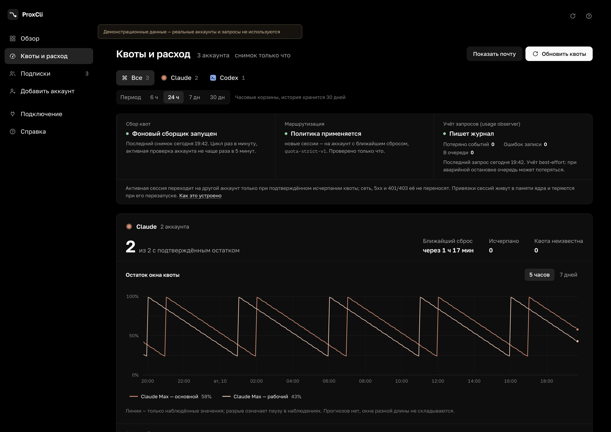
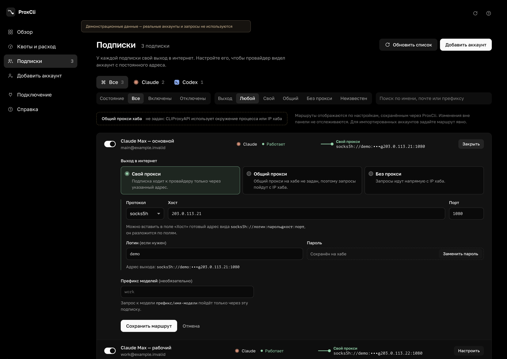
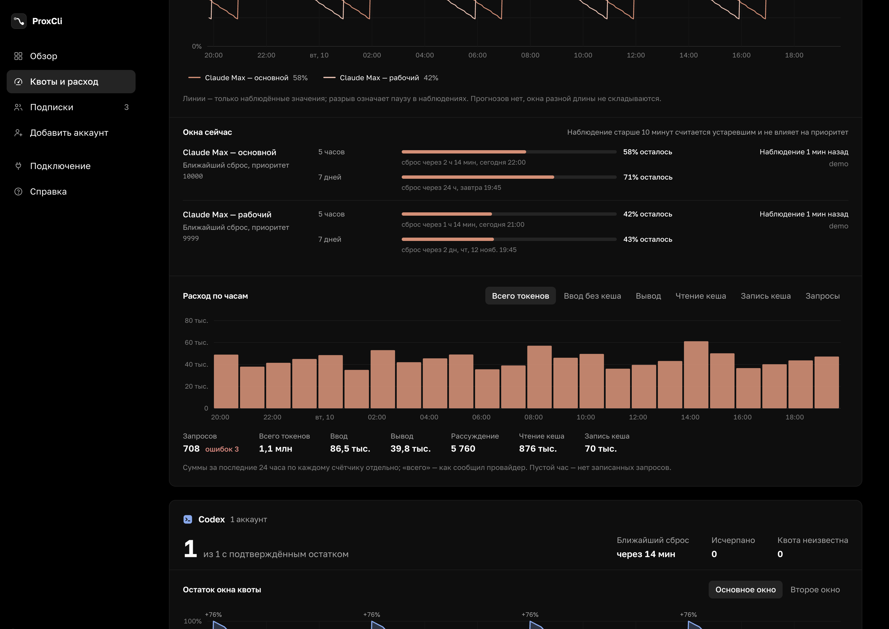

# ProxCli

Личный хаб для Claude Code и Codex: общий пул подписок, **отдельный прокси для каждого аккаунта**, история расхода и выбор аккаунта по ближайшему сбросу квоты.

[Релизы](https://github.com/pileskyd/proxcli/releases) · [Квоты и маршрутизация](docs/quotas-routing.md) · [Архитектура](docs/architecture.md) · [MIT](LICENSE)



*Скриншоты сняты с приложения в демо-режиме. Адреса, аккаунты и значения вымышленные; личные данные не используются. В обычном запуске панель показывает только данные подключённого хаба.*

## Что умеет

- Подключает Claude/Codex через OAuth на одном хабе; другим устройствам нужен его endpoint и клиентский ключ.
- Задаёт HTTP, HTTPS, SOCKS5 или SOCKS5h для каждой подписки. Выбранный прокси используется при OAuth, генерации и refresh токенов. Есть наследование общего маршрута и явный direct.
- Показывает окна квот и время сброса. Неизвестные и устаревшие значения не превращает в «0%» или «100%».
- Выбирает для **новой сессии** доступный аккаунт с ближайшим сбросом известного общего окна. Активная сессия сохраняет аккаунт, даже если изменились приоритеты.
- Автоматически переносит активную сессию **только при подтверждённом исчерпании квоты**. Сеть, 5xx, 401/403 и обычный rate limit не отправляют её на другой аккаунт ради одного запроса.
- Хранит 30 дней истории: ввод без кеша, вывод, reasoning, cache reads, cache writes и ошибки. Проценты квот и токены — разные показатели.
- Даёт конфиги Claude Code/Codex, инструкции Tailscale и отдельные каталоги настроек клиентов.





## Отличия от CLIProxyAPI и гайда Theo

ProxCli использует CLIProxyAPI v8.0.63, commit `6db7d4b839d86c5b24e17bbe73bcd4db18ef1b1a`. Перевод протоколов, OAuth, streaming, WebSocket, refresh и исполнение запросов остаются в ядре. Панель не стоит на пути inference. Патч добавляет `quota-strict` и изоляцию вызовов observer на Intel macOS.

| | CLIProxyAPI v8.0.63 | Подход Theo / T3 из гайда | ProxCli |
| --- | --- | --- | --- |
| Общий пул аккаунтов | Есть | Домашний always-on hub, клиенты через Tailscale | Та же схема, с собственной панелью |
| Прокси на аккаунт | Уже поддерживается ядром | В гайде отдельные прокси не описаны; акцент на домашнем IP | Редактор на каждую подписку, валидация URL, маскирование пароля, привязка до OAuth |
| Выбор по reset | Штатные round-robin/fill-first/weights | Theo описывает собственную доработку soonest-reset-first | Контроллер квот → priority → fill-first; точный патч включён в репозиторий |
| Активный диалог | Есть session affinity; стандартный `quota` допускает временный failover | В гайде affinity с TTL 1 ч | Новый `quota-strict`, без временного перехода на другой аккаунт; TTL 168 ч простоя |
| Квоты и расход | Watermark-заголовки, API и plugin hooks | На скриншоте есть pooled quota dashboard; его код в gist не приведён | История наблюдений и токенов, отдельные cache reads/writes, статус полноты журнала |
| Установка | Бинарь, brew, Docker и другие варианты | Ручная настройка хаба и клиентов | Готовые пакеты для macOS/Linux/Windows, конфиг и ключи генерируются локально |

Источники подхода: [gist Theo](https://gist.github.com/t3dotgg/59a521d2ee8d70aaf90e280c175072af), [видео](https://www.youtube.com/watch?v=D8PikZ1KhUo), [CLIProxyAPI](https://github.com/router-for-me/CLIProxyAPI). Проект независимый, не официальный клиент T3 или Router-For.ME.

## Запуск готового релиза

Скачайте архив из [Releases](https://github.com/pileskyd/proxcli/releases) под ОС и архитектуру хаба:

| Пакет | Платформа |
| --- | --- |
| `macos-arm64` | Mac с Apple Silicon |
| `macos-amd64` | Mac с Intel |
| `linux-amd64` | Linux x86-64 |
| `linux-arm64` | Linux ARM64 |
| `windows-amd64` | Windows x86-64 |

В архиве есть панель, подготовленное ядро, native usage-observer и web-ресурсы. **Bun и Go для запуска не нужны.** Linux-пакеты собираются и проверяются на Ubuntu 24.04; на старом дистрибутиве может потребоваться сборка из исходников. macOS/Windows-пакеты не подписаны сертификатом разработчика и не нотарифицированы. SHA-256 архивов опубликованы в `SHA256SUMS` рядом с релизом.

Распакуйте архив, перейдите в его корень. На macOS/Linux:

```sh
./bin/proxcli init
./bin/proxcli hub
```

В другом терминале из того же каталога:

```sh
./bin/proxcli serve
```

На Windows в PowerShell:

```powershell
.\bin\proxcli.exe init
.\bin\proxcli.exe hub
# В другом терминале, из того же каталога:
.\bin\proxcli.exe serve
```

Откройте **http://127.0.0.1:8787**. В разделе «Добавить аккаунт» выберите Claude/Codex и выход в интернет, затем пройдите вход в браузере. В разделе «Квоты и расход» проверьте состояние политики и observer. История начнёт появляться после новых запросов.

`init` создаёт `.env` и `.data/cliproxyapi.yaml` со случайными management/access ключами. Существующие настройки не заменяет и ключи не печатает. На POSIX файлы создаются с правами 0600; на Windows ограничьте доступ к каталогу своим пользователем через ACL. OAuth-файлы ядро по умолчанию хранит в `~/.cli-proxy-api`.

`serve` и `hub` читают `.env` из **текущего каталога**. Переменные уже заданного окружения имеют приоритет. Всегда запускайте команды из корня распакованного приложения. `proxcli version` показывает версию панели.

## Запуск из исходников

Нужны Go 1.26.10+ (CI использует 1.27.3), Bun, Git и C-компилятор: Xcode Command Line Tools на macOS, GCC/Clang на Linux, MinGW-w64 GCC на Windows. Ядро и observer собираются под ОС хаба; обычного `GOOS=...` для CGO недостаточно. Для упаковки релиза и native ABI-теста нужен Python 3.

```sh
git clone https://github.com/pileskyd/proxcli.git
cd proxcli
bun run build:core
bun run init
bun run hub
```

В другом терминале:

```sh
bun run dev
```

Dev UI: **http://127.0.0.1:5173**, Go API: `127.0.0.1:8787`. Vue работает с HMR; после изменения Go перезапустите dev-команду.

Production-сборка панели:

```sh
bun run build
bun run start
```

Теперь UI и API обслуживает один Go процесс на `:8787`. Ядро запускается отдельно через `bun run hub`. `build:core` клонирует точный upstream commit во временный каталог, проверяет применимость патча, выполняет тесты affinity и собирает `bin/cli-proxy-api` и `bin/plugins/proxcli-usage`. Временный checkout удаляется самим скриптом.

## Настройка

Переменные описаны в [.env.example](.env.example). Не публикуйте заполненный `.env`.

| Переменная | Назначение |
| --- | --- |
| `PROXCLI_UPSTREAM` | Корневой URL CLIProxyAPI, по умолчанию `http://127.0.0.1:8317` |
| `PROXCLI_MANAGEMENT_KEY` | Исходный management key хаба, не bcrypt-хеш из переписанного CPA-конфига |
| `PROXCLI_ACCESS_KEY` | Отдельный клиентский ключ для получения списка моделей |
| `PROXCLI_LISTEN` | Loopback-адрес панели, по умолчанию `127.0.0.1:8787` |
| `PROXCLI_DATA_DIR` | Каталог настроек и истории, по умолчанию `.data` |
| `PROXCLI_WEB_DIR` | Собранный UI, по умолчанию `web/dist` |
| `PROXCLI_MANAGE_ROUTING` | `true` для автоматического обновления priority |
| `PROXCLI_CORE_CONFIG` | Путь к конфигу для команды `proxcli hub` |

Ядро настраивается в `.data/cliproxyapi.yaml`: [пример](configs/cliproxyapi.example.yaml). Для работы строгой политики нужны `fill-first`, `session-affinity: true`, `session-affinity-rebind-on: quota-strict` и подготовленное ядро ProxCli. Панель проверяет capability ядра и отказывается объявлять политику активной при стороннем scheduler-плагине или Home mode.

Для существующего хаба можно скопировать `.env.example` в `.env` и подключить его management API. Управление подписками и сбор квот работают со штатным v8. Для `quota-strict` потребуется переход на подготовленное ядро и подключение observer — [порядок миграции](docs/quotas-routing.md#подключение-к-существующему-хабу).

### Прокси каждой подписки

- **Свой:** отдельный URL с credentials; по умолчанию SOCKS5h, чтобы DNS разрешался через прокси.
- **Общий:** пустой `proxy_url`, наследование настроек ядра и его окружения.
- **Без прокси:** явный `direct`, обход общего прокси и proxy-переменных окружения.

Для custom выбранный адрес передаётся ещё до OAuth, затем применяется к генерации и refresh. Upstream не принимает `direct` при старте OAuth: панель объяснит это и не подменит маршрут. Для прямого входа используйте общий маршрут хаба без глобального/env-прокси и задайте `direct` после входа.

CPA не возвращает per-auth proxy в списке аккаунтов. Поэтому импортированные маршруты показаны как неизвестные до явной настройки в ProxCli; изменения через другие инструменты не отслеживаются. Адрес прокси не является проверкой фактического egress IP.

### Подключение других машин

На хабе с Tailscale:

```sh
tailscale serve --bg --https=8317 http://127.0.0.1:8317
```

На странице «Подключение» укажите tailnet URL и **access key**, скопируйте настройки Claude Code/Codex. Для Codex в T3 Code используйте «Use existing CLI», чтобы использовался `config.toml` соответствующей машины. Конфиги Codex сверены с [официальной документацией](https://learn.chatgpt.com/docs/config-file/config-advanced).

Панель управления и management API оставлены на localhost. Для удалённого администрирования production-панели:

```sh
ssh -L 8787:127.0.0.1:8787 your-hub
```

Затем откройте http://127.0.0.1:8787 на клиенте. Автоматическая настройка Tailscale, системных служб и существующих конфигов клиентов не выполняется. Для always-on запуска используйте systemd user service или launchd с рабочим каталогом приложения и отдельными процессами `proxcli hub` / `proxcli serve`.

## Обновление

Перед обновлением сохраните **приватную** резервную копию `.env`, всего `.data` и каталога OAuth-файлов из `oauth.auth-dir`. В `.data/storage.key` находится ключ расшифровки настроек; сохраняйте его вместе с `.data/state.enc`.

Для готового релиза распакуйте новую версию в отдельный каталог, перенесите туда свои `.env` и `.data`, проверьте пути и права доступа. Не запускайте `init` повторно. Если обновляется только UI/панель, работающему ядру перезапуск не нужен. Для замены ядра или observer выберите перерыв между важными диалогами, остановите старый процесс и запустите новый.

Для исходников:

```sh
git pull --ff-only
bun run check
bun run build
# Если изменились версия ядра, патч или observer:
bun run build:core
```

**Affinity пока живёт в памяти ядра.** Перезапуск панели сохраняет связи работающего ядра; перезапуск самого CLIProxyAPI, смена режима/TTL, удаление аккаунта или истечение TTL могут их потерять. `quota-strict` защищает от ненужных переходов во время работы ядра, но не восстанавливает все диалоги после его рестарта.

## Разработка

- `web/src/views` и `web/src/components` — Vue UI, графики и редактор прокси.
- `internal/hub` — management adapter, collector и priority controller.
- `internal/telemetry` — нормализация квот, типизированный журнал и агрегация.
- `plugins/usage` — stdlib-only C ABI observer.
- `patches` — минимальные изменения закреплённого ядра и их тесты.
- `internal/bootstrap` — инициализация готового релиза и загрузка `.env`.

```sh
bun run check                    # Go -race, go vet, 8 frontend tests, typecheck, build
bun run build:core               # upstream auth tests + сборка ядра и observer
python3 scripts/test-plugin.py bin/plugins/proxcli-usage.dylib  # native ABI на macOS
bun run package                 # пакет текущей ОС после сборок UI и ядра
```

На Linux расширение observer — `.so`, на Windows — `.dll`, команда Python обычно `python`. Опциональный contract test с настоящим ядром описан в [validation.md](docs/validation.md).

Для демонстрации интерфейса без аккаунтов:

```sh
bun run build
bun run demo
```

Откройте http://127.0.0.1:8799/#/quotas. Демо-сервер не читает auth-файлы и не отправляет запросы провайдерам; OAuth и изменение аккаунтов в нём отключены. Этот режим использован для скриншотов выше.

Релиз создаётся тегом `vX.Y.Z`: GitHub Actions собирает и проверяет каждый native target, затем публикует архивы и `SHA256SUMS`, только если все jobs успешны. Workflow actions закреплены на commit SHA. Исходники и архивы проверяются отдельно: данные пользователя в пакет не копируются.

## Данные и ограничения

- Локальные настройки прокси и OAuth-сессии панели шифруются AES-256-GCM. Ключ лежит рядом с правами 0600; это не защита от компрометации всего каталога или пользователя ОС. Сам CPA сохраняет proxy credentials в своём auth-формате.
- История — дневные JSONL, retention 30 дней. Observer не забирает записи из общей usage-queue. Очередь best-effort; потери и ошибки диска видны в UI. Аварийное завершение может потерять ещё не записанные события.
- Квоты берутся из provider usage API и наблюдённых заголовков. Устаревшие данные не используются для ранжирования. Прошедший reset не подменяется значением 100%.
- Обычный 429 не всегда означает исчерпание подписки. При неоднозначном ответе строгий режим сохранит аккаунт и вернёт ошибку. Такая осторожность может потребовать повторного запроса вместо автоматического переноса.
- Расход и квоты — не финансовый биллинг. На реальных аккаунтах доступны только те счётчики, которые возвращает провайдер.
- Это локальная панель для личного хаба. Запускайте один процесс панели на каталог данных. Не публикуйте `.env`, `.data`, auth-файлы и management key. Использование подписок определяется условиями их провайдеров; гарантии от блокировок этот проект не даёт.

Подробности: [архитектура](docs/architecture.md), [политика квот и API](docs/quotas-routing.md), [проверки](docs/validation.md), [лицензии компонентов](THIRD_PARTY_NOTICES.md).
